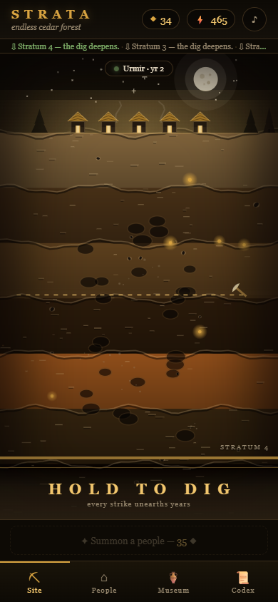

<div align="center">

# ⛏ STRATA — The Civilization Beneath

**An archaeological idle game where the civilization lives — and dies — in real time. While you sleep.**



**▶ Play: https://iamwinter1116-void.github.io/strata/**

*Install on Android/iOS · works fully offline · zero servers, zero cost*

</div>

---

You are a Surveyor digging into deep time. Beneath your dig site, a
procedurally generated civilization lives in real time — 0.5 years pass
for every second of yours. While you sleep, hundreds of years of its
history unfold: wars, plagues, miracles, golden ages. And every
civilization dies. You never know when.

## What makes it different

- ⏳ **A world that doesn't wait for you.** Real-time simulation with
  offline catch-up. Leave for 8 hours and return to find your
  civilization dead — buried under its successor. Its chronicle, its
  artifacts, its epitaph remain.
- ⚰️ **Procedural mortality.** Every civilization rolls a hidden
  doom-age at birth — plague, conquest, drought… or *they simply chose
  to leave.* Their epitaph enters your **Codex of the Dead**, forever.
- 🏺 **Every artifact has a true story.** Items are generated from the
  civilization's ACTUAL event history. A silver seal isn't just a silver
  seal — it's "a silver governor seal, from Velron-dor, buried in the
  year of the great flood." No two museums are alike.
- 🌍 **One shared world.** A daily UTC seed gives every player on Earth
  the same world theme that day. No servers, no accounts — just the
  same sky.
- 🖼 **A painted world.** Hand-drawn canvas cross-section: cratered
  moon, cedar silhouettes, a living village with glowing doorways, bold
  strata bands down to the abyss — with screen shake, particles,
  procedural audio, and haptics on every strike.

## Play

- **Web/PWA (installable):** https://iamwinter1116-void.github.io/strata/
  - **Android (Chrome):** install banner / ⋮ → *Add to Home screen* —
    installs as a real WebAPK, fullscreen, offline
  - **iOS (Safari):** Share → *Add to Home Screen*
- **HOLD to dig.** Every strike unearths years. Shards summon new
  peoples; artifacts fill your museum; the dead fill your codex.
- Keyboard-free, one-thumb friendly, no account, no permissions.

## Monetization (honest)

- **GameMonetize** — HTML5 network, 45% ad revenue share, 7,500+
  publishers. Ads ONLY at natural chapter-ends (stratum level-ups),
  throttled 1/3min, never in the first 4 minutes. No pay-to-win.
- **itch.io** — 90% dev share (page needs an account — TODO).
- The PWA itself stays ad-free. Store fees ($25 Google) would come from
  earnings only — never from pocket.

## Tech

Pure vanilla JS. Zero dependencies. Deterministic seeded simulation
(mulberry32 + FNV-1a) — the same world, testable in Node, alive in the
browser, from one source file. All assets procedural (icons from a
hand-rolled PNG encoder, sounds from oscillators, art from canvas code).

**123 automated tests:**

```
node tests/engine.test.js       # 64 — the simulation
node tests/ui.test.js           # 18 — boot/save/dig integration
node tests/monetization.test.js # 10 — ad bridge
node tests/e2e.js               # 31 — real Chrome playthrough
```

Serve first: `python -m http.server 8765` (e2e needs it + Chrome).

## Build for GameMonetize

```
node tools/build-gm.js <your_game_id>
# → dist/gamemonetize/strata.zip (SDK-activated, PWA bits stripped)
```

## Repo map

```
engine.js          the simulation (pure, deterministic)
app.js             game shell (rAF loop, hold-to-dig, panels, saves)
site.js            painted canvas dig-site
fx.js              juice: particles, shake, hit-stop, audio, haptics
monetization.js    ad bridge (inert until a real gameId)
tests/             64 + 18 + 10 + 31
tools/             icon generator · GameMonetize zip builder
docs/              screenshots
```

## License

MIT
